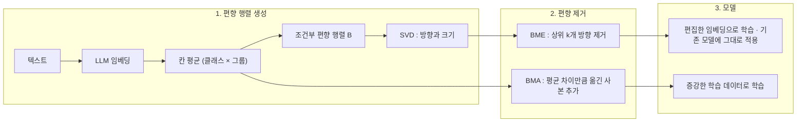

<div align="center">

# ⚖️ Bias-Matrix Editing and Augmentation

### Debiasing from Embeddings to Training Data

**조건부 편향 행렬 하나로 임베딩을 편집하고(BME) 학습 데이터를 증강하는(BMA) 편향 제거 방법**

[](https://www.python.org/)
[](https://numpy.org/)
[](https://scipy.org/)
[](https://pytorch.org/)

[🌐 프로젝트 페이지 · 데모](https://delta9043.github.io/Bias-matrix/) · [🎯 프로젝트 소개](#-프로젝트-소개) · [📦 설치](#-설치) · [🚀 빠른 시작](#-빠른-시작) · [📖 사용법](#-사용법) · [🧪 실험 재현](#-실험-재현) · [📁 폴더 구조](#-폴더-구조)

**2026 응용수학과 인공지능 빅데이터 챌린지 · 심화 부문**

</div>

---

## 🎯 프로젝트 소개

LLM 임베딩 위에서 분류 모델을 학습하면 학습 데이터의 편향(클래스와 그룹의 의존)이 **그룹 간 재현율(TPR) 격차**로 이어짐.  
이 저장소는 그 격차를 **조건부 편향 행렬 `B` 하나**로 줄이는 두 방법의 코드와 실험 결과.

```text
임베딩 + 클래스 · 그룹 라벨  ──▶  조건부 편향 행렬 B  ──▶  BME (임베딩 편집) · BMA (학습 데이터 증강)
```

| 구성 요소 | 설명 |
| --- | --- |
| 조건부 편향 행렬 `B` | 클래스 안에서 그룹 평균이 클래스 평균과 다른 정도를 열로 쌓은 행렬 (`d × CG`). SVD의 왼쪽 특이벡터 = 클래스 안의 그룹 차이가 큰 방향 |
| **BME** (Bias-Matrix Editing, 편향 행렬 편집법) | 임베딩에서 `B`의 상위 `k`개 특이방향 성분 제거 (논문 알고리즘 1) |
| **BMA** (Bias-Matrix Augmentation, 편향 행렬 증강법) | 임베딩은 그대로 두고, 같은 클래스의 다른 그룹 표본을 그룹 평균 차이만큼 옮긴 사본을 학습 데이터에 추가 (논문 알고리즘 2) |

- 클래스 : 예측 대상 (예 : 직업)
- 그룹 : 예측과 독립이어야 하는 속성 (예 : 성별)
- 칸 : 클래스와 그룹의 조합 하나

## ✨ 핵심 결과

Bias in Bios (약력 39.6만 건, 직업 28종, 성별) · Qwen3-0.6B 임베딩 (`d = 1024`) · 다항 로지스틱 회귀 기준.

| 방법 | 정확도 (%) | 보정 GAP | 요약 |
| --- | --- | --- | --- |
| Original | 81.9 | 0.162 | 편향 제거 없음 |
| **BME** (재학습) | 81.2 | 0.075 | 재현율 격차 54% 감소, 정확도 손실 0.7%p |
| **BME** (모델 고정) | 80.1 | 0.062 | 재학습 없이 62% 감소, 정확도 손실 1.8%p |
| **BMA** | 81.2 | 0.075 | CDA의 0.224배 분량으로 54% 감소 (CDA 30%) |

- 보정 GAP : 클래스별 재현율 격차의 RMS를 bootstrap으로 보정한 값
- 한국 공공데이터 (위해위험 소비자상담 내역, 품목 15종, 판매방식) : BME 29% 감소 (모델 고정 46%), BMA 12% 감소. 그룹이 셋인 경우에도 같은 방식으로 적용
- 전체 표와 그림 : [프로젝트 페이지](https://delta9043.github.io/Bias-matrix/) 또는 `results/tables.md`

## 🔄 방법 구조



- 1\. 편향 행렬 생성 : 학습 데이터의 임베딩과 라벨만 사용
- 2\. 편향 제거 : BME는 임베딩 자체를 편집, BMA는 학습 데이터에 사본 추가
- 3\. 모델 : BME는 재학습 없이도 적용 가능, BMA는 학습 단계에만 관여 (테스트 임베딩 변경 없음)

`k`(제거하는 방향의 수)는 순차 순열검정으로 선택.

## 🌐 프로젝트 페이지와 데모

주소 : **https://delta9043.github.io/Bias-matrix/** (`docs/` 폴더를 GitHub Pages로 배포)

| 구성 | 내용 |
| --- | --- |
| 방법 애니메이션 | 편향 행렬 생성 → SVD → BME · BMA 적용 과정을 단계별로 재생 |
| Demo 1 · 2D example | 클래스 2개 · 그룹 2개 합성 데이터. 편향 강도와 방법을 바꾸면 결정 경계와 그룹별 재현율 갱신 |
| Demo 2 · Real embeddings | Bias in Bios 의료 직업 7종의 실제 임베딩으로 브라우저에서 모델 학습. 직업별 재현율과 예시 문장의 예측 비교 |
| 실험 결과 | 논문의 그림 2~4와 표 2~3 (값 확인이 가능한 차트) |

- 로컬에서 보기 : `docs/index.html`을 브라우저로 열기, 또는 `python -m http.server --directory docs 8000` 후 `http://localhost:8000` 접속 (수식 · 글꼴은 CDN 사용, 인터넷 연결 필요)
- 배포 : 저장소 Settings → Pages → Branch `main`, 폴더 `/docs`
- Demo 2는 논문 실험의 축소 설정 (학습 표본 8,000건, 주성분 64개, 테스트 28,282건). 수치는 논문의 표와 다름
- 데모의 계산 코어 `docs/assets/bm-core.js` : 그룹이 둘인 경우만 구현

페이지에 들어가는 데이터 생성 · 검증 (저장소 루트에서 실행) :

| 명령 | 용도 |
| --- | --- |
| `python -m demo.build_page_data` | `results/`의 표 · 본문 수치 · 그림 계열 · 애니메이션용 합성 표본 → `docs/assets/page-data.js` (임베딩 불필요) |
| `python -m demo.build_demo_data` | Demo 2 데이터 → `docs/assets/demo-data.js` (Bias in Bios 임베딩과 LLM 필요) |
| `python -m demo.reference && node demo/check_core.js` | 데모 데이터에서 Python 라이브러리와 브라우저 계산 코어의 결과 대조 |

## 📋 준비

| 항목 | 내용 |
| --- | --- |
| Python | 3.14에서 결과 확인 (패키지 버전 : `requirements.txt`) |
| 라이브러리 사용 | `numpy`, `scipy` |
| 실험 재현 | `torch`, `transformers`, `huggingface_hub`, `pandas`, `pyarrow`, `matplotlib` |
| 계산 장치 | Intel GPU(`xpu`) → CUDA → CPU 순으로 자동 선택 (`--device`로 변경). 본문의 결과는 Intel Arc 내장 GPU에서 산출 |
| 데이터 | Bias in Bios는 자동 내려받기, 위해위험 상담 CSV는 직접 배치 ([데이터](#-데이터) 참고) |
| Node.js | 데모 계산 코어 대조(`demo/check_core.js`) 시에만 필요 |

## 📦 설치

```bash
# 1) 저장소 내려받기
git clone https://github.com/delta9043/Bias-matrix.git
cd Bias-matrix

# 2) 가상 환경 (Windows 기준. Linux · macOS는 .venv/bin/python)
python -m venv .venv

# 3-a) 방법만 사용
.venv/Scripts/python -m pip install numpy scipy

# 3-b) 실험 재현까지 (torch는 환경에 맞는 빌드. 아래는 Intel GPU 빌드)
.venv/Scripts/python -m pip install torch --index-url https://download.pytorch.org/whl/xpu
.venv/Scripts/python -m pip install transformers huggingface_hub numpy scipy pandas pyarrow matplotlib pytest concept-erasure
```

- `concept-erasure` : LEACE 구현과 대조하는 테스트 하나에만 사용. 없으면 해당 테스트 건너뜀

설치 확인 :

```bash
.venv/Scripts/python -m pytest tests -q
```

정상 출력 예 :

```text
16 passed in 2.57s
```

## 🚀 빠른 시작

임베딩 행렬과 클래스 · 그룹 라벨만 있으면 적용 가능.

```python
import numpy as np
import bias_matrix as bm

# X: (n, d) 임베딩, y: 클래스 0..C-1, z: 그룹 0..G-1 (정수 배열)

# BME (알고리즘 1): 학습 임베딩에서 추정, 같은 변환을 모든 임베딩에 적용
eraser = bm.bme(X_train, y_train, z_train)            # 모든 방향, 사교 편집
X_train_edit, X_test_edit = eraser(X_train), eraser(X_test)

# 순차 순열검정으로 방향의 수 k 선택
k, s, threshold = bm.select_rank(X_train, y_train, z_train)
eraser_k = bm.bme(X_train, y_train, z_train, k=k)

# BMA (알고리즘 2): 학습 데이터에 붙일 사본
X_new, y_new, z_new = bm.bma(X_train, y_train, z_train, rng=0)
X_aug = np.concatenate([X_train, X_new])
y_aug = np.concatenate([y_train, y_new])
```

- BME : 편집한 임베딩으로 모델을 다시 학습하거나, 이미 학습된 모델의 입력에 그대로 적용
- BMA : `X_aug`, `y_aug`로 모델만 다시 학습. 테스트 임베딩은 변경 없음

## 📖 사용법

### 🧩 주요 함수

| 함수 | 반환 | 설명 |
| --- | --- | --- |
| `bme(X, y, z, k=None, oblique=True, shrink=None)` | `Eraser` | 학습 임베딩에서 BME 추정. `eraser(X)`로 임의의 임베딩 편집 |
| `select_rank(X, y, z, n_perm=200, alpha=0.05, rng=None)` | `(k, s, thr)` | 순차 순열검정으로 방향의 수 선택. `s` 특이값, `thr` 임계값 |
| `bma(X, y, z, rng=None)` | `(X_new, y_new, z_new)` | 최소 증강 계획의 칸에 넣을 사본과 그 라벨 |
| `conditional_bias_matrix(X, y, z, weights="cell")` | `B (d, C·G)` | 조건부 편향 행렬. `weights="uniform"`은 표본 수 가중치 없는 변형 |
| `bme_eraser(B, mean, cov=None, k=None, shrink=None)` | `Eraser` | 통계량에서 편집 연산 직접 구성 (`cov=None` 직교, 지정 시 사교) |
| `cell_stats` · `minimal_plan` · `plan_sources` · `mean_shift` | - | BMA를 단계별로 쓸 때 (칸 평균 → 최소 계획 → 원본 선택 → 평균 이동) |

### ⚙️ BME 옵션

| 인자 | 값 | 뜻 |
| --- | --- | --- |
| `k` | `None` (기본) | `B`의 모든 방향 제거 (랭크만큼) |
| | 정수 | 상위 `k`개 방향만 제거 |
| `oblique` | `True` (기본) | 사교 편집 : 공분산으로 백색화한 공간에서 사영. 임베딩 변화가 가장 작음 |
| | `False` | 직교 편집 : 알고리즘 1의 식 그대로 |
| `shrink` | `None` (기본) | hard editing : 특이값을 0으로 |
| | `0 < λ < 1` | soft editing : 특이값을 `λ`배로 축소 |

### ➕ BMA 단계

1. `cell_stats` : 칸별 평균과 표본 수
2. `minimal_plan` : 클래스와 그룹이 독립이 되는 최소 추가량과 목표 그룹 비율
3. `plan_sources` : 칸마다 같은 클래스의 다른 그룹에서 원본 선택
4. `mean_shift` : 원본을 그룹 평균 차이만큼 옮겨 사본 생성

`bma`는 1~4를 한 번에 수행.

## 🧪 실험 재현

### 📂 데이터

| 데이터&nbsp;·&nbsp;모델 | 출처 | 배치 |
| --- | --- | --- |
| Bias&nbsp;in&nbsp;Bios | `LabHC/bias_in_bios` (Hugging Face, MIT) | 첫 실행 시 `data/bias_in_bios/`로 자동 내려받기 (학습 257,478건 · dev 39,642건 · 테스트 99,069건) |
| 임베딩&nbsp;모델 | `Qwen/Qwen3-0.6B` (Hugging Face, Apache-2.0) | 첫 실행 시 Hugging Face 캐시로 자동 내려받기 |
| 위&#8288;해&#8288;위&#8288;험&nbsp;소&#8288;비&#8288;자&#8288;상&#8288;담&nbsp;내&#8288;역 | [공공데이터포털 「공정거래위원회_소비자 민원학습데이터 위해위험 소비자상담 내역 데이터」](https://www.data.go.kr/data/15098320/fileData.do) (이용허락범위 제한 없음) | 내려받은 CSV를 `data/consumer/hazard_15098320.csv`로 직접 배치 |

- 위해위험 상담 : CP949, 129,759행 중 열 수가 맞지 않는 64행 제외
- 그룹 : 판매방식코드 10 = 일반 판매, 24 · 27 = 비대면 판매. 코드표를 찾지 못해 24 · 27의 뜻(인터넷 판매, 홈쇼핑 판매)은 상담 본문의 단어로 추정 (24의 36%에 인터넷 · 쇼핑몰 · 온라인, 27의 78%에 홈쇼핑 등장, 10에서는 각각 4%, 0.5%)
- 클래스 : 품목코드 앞 두 자리(대분류). 1,000건 이상이고 두 판매방식에 각각 100건 이상 있는 15종 (학습 83,641건 · 테스트 20,911건, 8:2 무작위 분할)
- 품목 대분류 이름 : 같은 포털의 품목코드표 (https://www.data.go.kr/data/15098317/fileData.do). 이 저장소의 코드는 해당 파일을 읽지 않음
- 데이터 폴더 변경 : 환경 변수 `BIAS_MATRIX_DATA` (기본 `./data`)
- 추출한 임베딩 : `data/emb/Qwen3-0.6B/` 아래 약 6GB (층 7 · 14 · 21 · 28, float16)

### ▶️ 실행

저장소 루트에서 실행 (Windows는 Git Bash 기준).

```bash
export PYTHON=.venv/Scripts/python     # 생략 시 PATH의 python
bash run_embed.sh                      # 임베딩 추출 (중단 후 재실행 시 끝난 청크는 건너뜀)
bash run_experiments.sh                # 테스트 → 층 · L2 선택 → 실험 → 그림 · 표
```

- 실험 하나만 실행 : `python -m experiments.removal`, `python -m experiments.dose --data hazard` 등
- 재실행 시 `results/`의 JSON 덮어쓰기. 실린 결과를 보존하려면 `BIAS_MATRIX_RESULTS=<폴더>` 지정
- 그림 · 표만 재생성 (임베딩 불필요) : `python -m experiments.figures`, `python -m experiments.tables`
- 임베딩 추출 속도 : Intel Arc 내장 GPU(fp16) 초당 약 100문장, CPU 초당 약 6문장

### 🗺️ 실험과 본문의 대응

| 명령 | 결과 파일 | 본문 |
| --- | --- | --- |
| `python -m experiments.select_layer` | `select.json` | 임베딩 층과 L2 세기 선택 (dev 정확도 기준, 층 28 · L2 0.001) |
| `python -m experiments.spectrum` | `spectrum.json` | 그림 1의 4단계 (특이값과 순열검정 임계값), 5.2절의 선택된 방향의 수 |
| `python -m experiments.removal` | `removal.json` | 표 2 위쪽 (임베딩 편집), 그림 2b의 LEACE · INLP, 그림 2c |
| `python -m experiments.frozen` | `frozen.json` | 표 2의 "BME (Ours, 모델 고정)" |
| `python -m experiments.augmentation` | `augmentation.json` | 표 2 아래쪽 (reweighing, CDA, BMA), 그림 2b의 점, 그림 3c |
| `python -m experiments.dose --data bios` | `dose_bios.json` | 그림 2a, 그림 3a · 3b |
| `python -m experiments.tradeoff --data bios` | `tradeoff_bios.json` | 그림 2b의 BME 선 2개 |
| `python -m experiments.hazard` | `hazard.json` | 표 3 위쪽 (그룹 2개), 그림 4b의 점, 그림 4c |
| `python -m experiments.multigroup` | `multigroup.json` | 표 3 아래쪽 (그룹 3개) |
| `python -m experiments.rare_cells` | `rare_cells.json` | 5.4절의 드문 품목 재현율 |
| `python -m experiments.dose --data hazard` | `dose_hazard.json` | 그림 4a |
| `python -m experiments.tradeoff --data hazard --inlp` | `tradeoff_hazard.json` | 그림 4b의 BME 선과 INLP |
| `python -m experiments.figures` | `figures/fig1_overview.png` ~ `fig4_korea.png` | 그림 1~4 |
| `python -m experiments.tables` | `tables.md`, `tables.json` | 표 2~3, 본문 수치 |

### 🏷️ 결과 행 이름과 지표

| 행 이름 | 뜻 |
| --- | --- |
| `none` | 원본 모델 |
| `bme` | BME (사교 편집, 모든 방향, 재학습) |
| `bme-orth-k` | 직교 편집으로 상위 `k`개 제거 |
| `bme-soft-0.25` | soft editing (`λ = 0.25`) |
| `bme-frozen` | 모델 고정, 임베딩만 편집 |
| `bme-uniform` | 편향 행렬의 열에 표본 수 가중치 없이 방향의 순서를 정한 경우 (그림의 "클래스 균등") |
| `X-top-k` | 데이터 행렬 `X`의 상위 `k`개 제거 |
| `leace`, `inlp-t`, `inlp-class-t` | LEACE, INLP (반복 `t`회), INLP 직업 보정 변형 |
| `reweighing`, `cda-all`, `cda-partial` | reweighing, 모든 문장 또는 BMA와 같은 칸에만 성별 단어를 바꾼 문장 추가 |
| `bma`, `bma-all` | BMA (최소 계획), 모든 표본의 사본 추가 |

| 지표 | 뜻 |
| --- | --- |
| `acc` | 정확도 |
| `gap_rms` | 클래스별 재현율 격차의 RMS |
| `gap_rms_bc`, `gap_rms_ci` | bootstrap으로 보정한 값(본문의 보정 GAP)과 95% 구간 |
| `tpr_minority`, `tpr_majority` | 각 클래스에서 학습 데이터가 가장 적은 · 많은 그룹의 재현율 평균 |

### 🔁 재현성

- `results/`의 JSON = 본문의 수치를 낸 실행의 결과 (본문에 쓰지 않는 행과 항목만 제외). `python -m experiments.figures`, `python -m experiments.tables`로 본문의 그림(픽셀 단위 동일) · 표 · 수치 재생성
- 난수 시드는 스크립트 안에 고정. 단, GPU에서 학습한 모델은 실행마다 비트 단위로 같지 않아 재실행 시 테스트 예측 일부가 달라짐 (편향 강도 실험의 한 설정에서 같은 학습을 반복했을 때 99,069개 중 45~72개)
- 같은 임베딩으로 스크립트를 재실행해 `results/`와 비교한 차이 (2026-11-21, Intel Arc 내장 GPU. `dose`는 5회 반복 중 첫 번째만 재실행) :

| 실험 | 정확도 차이의 최댓값 (%p) | 보정 GAP 차이의 최댓값 | 실행 시간 |
| --- | --- | --- | --- |
| `select_layer` | 0.028 (dev 정확도) | - | 5분 |
| `spectrum` | - | - (선택된 `k` 동일, 특이값 · 임계값 차이 1e-15 이하) | 1분 미만 |
| `removal` | 0.019 | 0.0015 | 17분 |
| `frozen` | 0.008 | 0.0004 | 1분 미만 |
| `augmentation` | 0.005 | 0.0007 | 4분 |
| `dose --data bios` | 0.016 | 0.0056 | 14분 (1회 반복) |
| `tradeoff --data bios` | 0.013 | 0.0012 | 9분 |
| `hazard` | 0.010 | 0.0002 | 1분 미만 |
| `multigroup` | 0.008 | 0.0006 | 1분 미만 |
| `rare_cells` | 0.014 | - (드문 칸의 재현율 동일) | 1분 미만 |
| `dose --data hazard` | 0.019 | 0.0007 | 5분 (1회 반복) |
| `tradeoff --data hazard --inlp` | 0.019 | 0.0007 | 2분 |

- 보정 GAP의 차이는 대부분 0.001 이내. Bias in Bios의 편향 강도 실험에서는 재실행한 30개 행 중 2개가 더 크게 달랐음 (BME의 α = 0.25에서 0.0056, LEACE의 α = 0.75에서 0.0039). 원인 : 테스트 표본이 34건뿐인 칸(여성 rapper)의 예측 한두 개가 실행마다 바뀜. 같은 데이터로 같은 모델을 네 번 학습한 보정 GAP = 0.084~0.089 (BME, α = 0.25)
- 재실행 결과로 표를 만들면 표 2의 65칸 중 16칸, 표 3의 40칸 중 4칸이 마지막 자리에서 달라짐 (예 : BME의 보정 GAP 0.075 → 0.076)
- 본문의 결과를 낸 실행에는 본문에 싣지 않은 대조 실험이 함께 있었고 같은 난수 생성기를 사용. 같은 표본이 뽑히도록 `removal.py`, `augmentation.py`, `multigroup.py`는 그 실험이 쓰던 만큼의 난수를 먼저 소비 (주석 `random stream of the reported run`)
- `frozen.json`, `rare_cells.json`, `tradeoff_*.json`의 원본 모델은 다른 결과 파일의 원본 모델과 설정이 같지만 따로 학습한 것. 같은 모델의 수치가 파일마다 위와 같은 크기로 다름

## 📁 폴더 구조

```text
Bias-matrix/
├── README.md                ← 이 문서
├── requirements.txt         결과를 낸 패키지 버전
├── run_embed.sh             임베딩 추출 (전체)
├── run_experiments.sh       테스트 → 실험 → 그림 · 표
├── bias_matrix/             방법 라이브러리 (numpy · scipy만 사용)
│   ├── stats.py               칸별 평균 · 표본 수, 공분산, 상호정보량
│   ├── bme.py                 조건부 편향 행렬, BME 편집 연산, 순차 순열검정
│   └── bma.py                 최소 증강 계획, 평균 이동 사본, BMA
├── experiments/             본문의 실험 (torch 사용)
│   ├── common.py              경로, 임베딩 · 결과 입출력, 그림 양식
│   ├── data.py                Bias in Bios · 위해위험 상담 로드, 성별 단어 치환 (CDA용)
│   ├── embed.py               Qwen3-0.6B 임베딩 추출 (층별 평균 풀링, 청크 단위 이어하기)
│   ├── models.py              다항 로지스틱 회귀 (L2 정규화, L-BFGS)
│   ├── metrics.py             재현율 격차 지표, bootstrap 보정과 95% 구간
│   ├── baselines.py           LEACE, INLP, reweighing, 데이터 행렬 X 대조
│   ├── <실험>.py              실험 하나에 스크립트 하나 (실험과 본문의 대응 참고)
│   ├── figures.py             그림 1~4
│   └── tables.py              표 2~3, 본문 수치
├── tests/
│   └── test_math.py           명제 1~3과 구현의 수치 검증 (합성 데이터)
├── results/                 본문에 실린 결과
│   ├── *.json                 실험별 결과
│   ├── tables.md · tables.json  표와 본문 수치
│   └── figures/               그림 1~4 (PNG)
├── demo/                    프로젝트 페이지의 데이터 생성 · 검증
│   ├── build_page_data.py     결과 → docs/assets/page-data.js
│   ├── build_demo_data.py     Demo 2 데이터 → docs/assets/demo-data.js
│   ├── examples.json          Demo 2의 예시 약력 (지어낸 문장)
│   ├── reference.py           데모 데이터에서의 Python 기준값
│   └── check_core.js          브라우저 계산 코어와 기준값 대조
└── docs/                    프로젝트 페이지 (GitHub Pages)
    ├── index.html
    └── assets/                스타일, 차트 · 애니메이션 · 데모 스크립트, 데이터
```

- 방법만 쓸 때 필요한 폴더 : `bias_matrix/`
- `experiments/`, `results/` : 본문의 실험 재현용

## ✅ 테스트 실행 방법

| 명령 | 검증 범위 |
| --- | --- |
| `python -m pytest tests -q` | 명제 1~3과 구현 (편향 행렬, 편집 연산, 순열검정, 최소 증강 계획, 사본, 지표) |
| `python -m demo.reference && node demo/check_core.js` | 데모 데이터에서 브라우저 계산 코어와 Python 라이브러리의 일치 (원본 · BME · 최소 계획 · BMA) |

정상 출력 예 :

```text
16 passed in 2.57s
all checks passed
```

## ⚠️ 주의 사항

- GPU 학습의 비결정성으로 재실행 수치가 마지막 자리에서 달라질 수 있음 ([재현성](#-재현성) 참고)
- CUDA · CPU 경로와 전체 실행 스크립트(`run_embed.sh`, `run_experiments.sh`)의 일괄 실행은 확인하지 못함. 개별 실험은 Intel GPU에서 실행 확인
- 위해위험 상담의 판매방식 코드 뜻은 코드표가 아닌 상담 본문의 단어로 추정한 것
- Demo 2는 논문 실험의 축소 설정이며, 예시 약력은 지어낸 문장 (실존 인물의 약력 미포함)
- 데이터와 모델의 이용 조건은 각 출처를 따름 (Bias in Bios : MIT, Qwen3-0.6B : Apache-2.0, 공공데이터포털 : 이용허락범위 제한 없음)

### 👤 저자

- **Sanghyeok Moon** · Department of Applied Mathematics, Kyung Hee University

---

<div align="center">

**Bias-Matrix Editing and Augmentation — 편향 행렬 하나로, 임베딩에서 학습 데이터까지 ⚖️**

</div>
